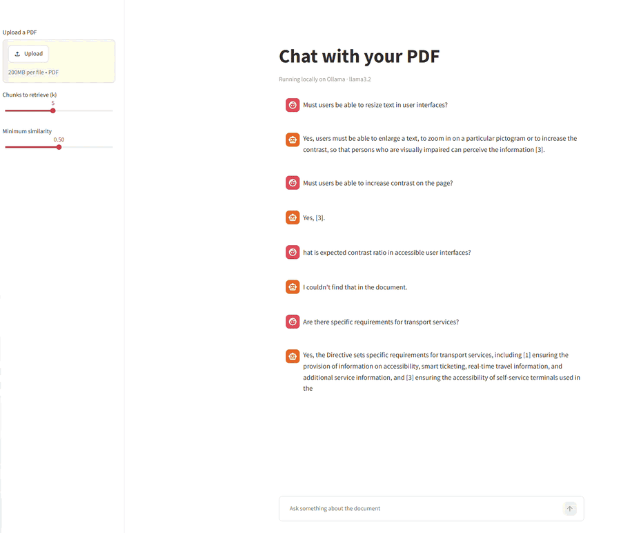
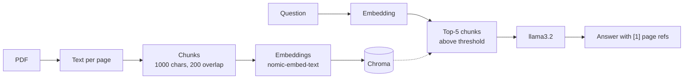

# Local RAG Chatbot – chat with your PDF, fully offline

Ask questions about a PDF and get answers with **page-level citations**, running entirely on your machine with [Ollama](https://ollama.com). No API keys, no cost per question, no data leaves your computer.

Demo document: an EU accessibility directive (`data/EU_Directive_Accessibility.pdf`, source: [EUR-Lex](https://eur-lex.europa.eu)).



## How it works



- **Chunks never cross page boundaries**, so every citation points to one page.
- **Hallucination guards:** a similarity threshold (`MIN_SCORE`), a strict system prompt, and citation numbers validated in code.
- **Stack:** `pypdf`, Ollama (`nomic-embed-text` + `llama3.2`), Chroma, Streamlit.

## Quick start

Requires Python 3.10–3.12 (64-bit) and [Ollama](https://ollama.com/download).

```bash
ollama pull nomic-embed-text
ollama pull llama3.2

python -m venv .venv
.venv\Scripts\activate             # macOS/Linux: source .venv/bin/activate
pip install -r requirements.txt

python ingest.py data/
python ask.py "Must users be able to resize text in user interfaces?"
streamlit run app.py
```

Swap models with environment variables: `CHAT_MODEL` (e.g. `qwen2.5:7b`) and `EMBED_MODEL` (e.g. `bge-m3` for non-English PDFs; re-run `ingest.py` afterwards).

## Evaluation

`eval_set.json` has 16 questions labelled with the page holding the answer, plus 5 off-topic questions, including same-topic ones the directive doesn't answer. `python eval.py` reports retrieval hit rate and suggests a `MIN_SCORE`.

| Questions | hit@1 | hit@3 | hit@5 | Suggested MIN_SCORE | Correct threshold decisions |
| --- | --- | --- | --- | --- | --- |
| 16 + 5 | 56% | 94% | 100% | 0.59 | 86% (18 of 21) |

Key findings:

- **Retrieval is reliable:** the correct page is always in the top 5 chunks the LLM receives. The lower hit@1 points to re-ranking as the next step.
- **A threshold filters unrelated questions, not related ones.** At 0.59 every answerable question gets through and 2 of 5 off-topic ones are blocked. The 3 that get through are same-topic questions (scores 0.67–0.70) that overlap with real ones, so the system prompt has to handle them.
